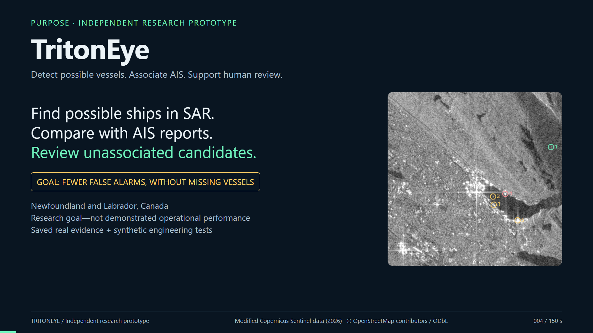

# TritonEye

Newfoundland and Labrador SAR/AIS maritime target research pipeline.

Independent maritime AI research project.
**Research prototype, not a validated operational surveillance
system. Native-NL vessel precision, overall recall and false-alarm rate remain
unmeasured.** Unmatched returns are unassociated candidates, not confirmed dark vessels.

**Start here: [Reviewer guide — built, measured and blocked](docs/REVIEWER_GUIDE.md).**
For a five-minute review: [saved real Newfoundland case](examples/nl-real-case.html),
[demo and lifecycle rehearsal](docs/PORTFOLIO_DEMO.md), and
[technical explanation / AI-assistance disclosure](docs/TECHNICAL_EXPLANATION.md).
The [synthetic demonstration](#offline-synthetic-demonstration) is separate.

### Watch the 2½-minute walkthrough

[](docs/media/tritoneye-walkthrough.mp4)

[Open the video](docs/media/tritoneye-walkthrough.mp4) · 2:30 · narrated, 1080p.
The walkthrough explains the project purpose, a **saved real Newfoundland SAR
case**, coastal exclusions and association uncertainty, separately identified
**synthetic lifecycle tests**, and the **Statoil/Kaggle ship-versus-iceberg
experiment**. Limited matched AIS and trustworthy NL labels constrain training
and evaluation; the competition-chip result is not real-NL detection accuracy.
This is a presentation of recorded evidence, not a new live pipeline run or
independent validation. Includes synthetic narration. Imagery attribution:
modified Copernicus Sentinel data (2026); saved shoreline policy derives from
© OpenStreetMap contributors, ODbL. No AIS tracks or restricted Kaggle chips
are included.

## Current status — 15 October 2026

Engineering baseline: `259d592` ([PR #44](https://github.com/haseebkn/TritonEye/pull/44)).
[Main CI passed](https://github.com/haseebkn/TritonEye/actions/runs/38810857035):
unit tests, lint/types and Docker. Local validation passed 1,113 tests with two
slow tests excluded; a subsequent focused regression/guard run passed 260.
These are software checks, not independent scientific validation. Historical
experiments retain their original dates, code versions and hashes.

| Built and exercised | Measured evidence | Not established |
| --- | --- | --- |
| Exact-product ingestion, calibrated VV/VH inference, georeferencing, NL filtering, SAR–AIS association and coastal exclusions | [3/3 AIS-supported vessel-scene proximity observations across two scenes](docs/AIS_SUBSET_RESULT.md), at 500 m; conditional exact 95% interval **29.2%–100%** | Overall detection accuracy, correct identities, low false alarms or province-wide performance. The interval assumes independent trials and does not correct scene clustering or selection bias. |
| Versioned 21-area provisional benchmark and six exploratory fits: three limited xView3 bias fits and three frozen-CROMA token-head fits | [Development runs](docs/DEVELOPMENT_EXPERIMENTS.md) used one provisional VV/VH training vessel; the [baseline](docs/NL_BASELINE_V020.md) records processing and resources | Useful native-NL detector improvement or an approved operating threshold |
| Separate ship-versus-iceberg classifier, experimental HH/HV contrast candidate generator and native preprocessing checks | [Kaggle/Statoil chip holdout](docs/STATOIL_BASELINE.md): 87.97% CNN accuracy versus 58.92% logistic regression on 241 chips | Transfer to real NL SAR, fewer vessel-detection false positives, or safe iceberg filtering without vessel losses |
| Local model registration, paired shadow evaluation, guarded promotion and transactional rollback | [Lifecycle rehearsals and failure tests](docs/MODEL_LIFECYCLE.md); real promotion correctly blocked | Approved model deployment, automated retraining or an operational MLOps service |

The calibration lookup now rejects a wrong measurement/polarization rather than
substituting another LUT. The overlap audit rejects heartbeat spans interrupted
by disconnect, reconnect or session-stop events.
[Fixes and historical replay limits](docs/ACQUISITION_RELIABILITY.md):
two historical reservation releases retain old source hashes and deliberately
refuse verification with changed code; exact replay requires the documented
original commit. Their frozen evidence was not rewritten.

## What data access does — and does not — prevent

Public SAR imagery and several reference datasets have already been obtained.
**The blocker is not that no public NL data exists.** The project has not secured
sufficient eligible, co-temporal AIS and trustworthy object labels for its chosen
training regions and acquisitions. The following are different problems:

| Constraint | Consequence today | What would help |
| --- | --- | --- |
| Sparse received AIS, historical gaps and no live-feed backfill | Cannot build enough split-safe SAR–AIS training pairs or establish competing vessel identities from the archive | Authorized historical tracks or denser prospective reception at exact SAR passes; receiving a feed is not proof of area-wide coverage |
| AllenAI NL annotation permission and completeness unresolved | Audited labels remain quarantined, not usable training truth | Dataset-specific clarification, alignment/class decisions, completeness policy and compatible native contexts; permission alone is insufficient |
| IIP sightings and optical leads lack adequate same-object corroboration | Plausible iceberg interpretations remain provisional, not confirmed iceberg labels | Better time/position evidence and corroboration accounting for drift, source uncertainty and cloud/coverage limits |
| No independent reviewer; incomplete/uncertain labels | Cannot claim accepted native precision/recall, false-alarm rates, selected thresholds or promotion | Complete-area labels, independent review and held-out evaluation; another AI or self-review does not satisfy the guard |
| Polarization/domain shift and limited training supervision | HH/HV experiments cannot be advertised as validated xView3 or Kaggle transfer | Native input qualification and controlled learning/filter comparisons on suitable labels; matching 75×75 dimensions alone is insufficient |

These are recorded project findings, **not proof that suitable public data is
unavailable everywhere**, nor that buying data alone would finish validation.
The [reviewer guide](docs/REVIEWER_GUIDE.md#3-blocked-or-not-implemented--why-and-what-would-resolve-it)
separates access, review, compatibility and unimplemented engineering in detail.

The [deployed recorder and frozen collection plan](docs/TARGETED_AIS_COLLECTION.md)
reserve October 17, 18 and 20 HH/HV opportunities, after the October 16 application
deadline. These are future collection windows, not delivered imagery or labels.
No real labels have been admitted by the new native HH/HV admission/export workflow;
this is distinct from the earlier one-positive VV/VH exploratory fits.
Review guards, AllenAI quarantine and the locked test set remain in force.

## What the project demonstrates

- Calibrated Sentinel-1 VV/VH processing, fixed-size model tiling, GCP/affine
  georeferencing, and GeoJSON outputs restricted to an explicit NL study polygon.
- A pinned xView3 SAR ensemble; experimental SAR-only YOLO is optional.
  No generic detector fallback and no invented vessel-type labels.
- UTC AIS validation, bounded motion alignment and geodesic one-to-one target
  assignment, retaining ambiguous matches and missing-coverage states.
- Separate physical land/water classification and coastal eligibility policy,
  preserving coastal research returns independently of open-water candidates.
- Auditable policy exclusions and provisional fixed-infrastructure
  proximity flags. Nominal mobile FPSO positions are not permanent masks.
- Per-mission input/model hashes, processing parameters, stage logs, MLflow
  experiment/model provenance, unit tests, and Docker/CI configuration.
- An analyst report with offline-readable evidence tables and an optional map.

The pipeline is **ingest → inference → correlate → evaluate → report**. A failed
stage stops the mission; failed model tiles never silently become a complete scan.
A target without an AIS match is **not proof of a dark vessel or intent**.
Automatic operational alerts are disabled pending regional validation.

Saved real-scene AIS comparisons provide supporting proximity evidence;
see [the observed result, interval, hashed evidence and limitations](docs/AIS_SUBSET_RESULT.md).

Regional shoreline controls, coastal/open-water replay counts and remaining
label/coverage gaps: [COASTAL_POLICY.md](docs/COASTAL_POLICY.md).

SAR annotation now has a [versioned NL benchmark draft](datasets/nl_benchmark/v0.2.0/DATASET_CARD.md),
with 21 complete selected areas, acquisition/geographic split locks and hashed
provenance. The [Step 3 expansion report](docs/NL_BENCHMARK_V020.md) documents nine
new image-first passes and five provisional vessel interpretations with AIS
support. Independent review is unavailable; accuracy remains unmeasured.

The [NL baseline and operating-point protocol](docs/NL_BASELINE.md) separates
processing coverage, resource use and descriptive returns from unavailable
accuracy. Validation-only threshold selection requires useful recall and coverage
as well as a low false-alarm bound; it cannot succeed by withholding everything.
The [v0.2.0 replay](docs/NL_BASELINE_V020.md) extends this accounting to the
expanded development set; independent accuracy remains unavailable.

The [model development status](docs/MODEL_DEVELOPMENT.md) includes frozen CROMA
radar features and an [exploratory positive-only training protocol](docs/DEVELOPMENT_EXPERIMENTS.md)
for a limited xView3 head fine-tune and a CROMA token head. Reviewed accuracy and
controlled improvement remain blocked by label and coverage gaps. HH/HV remains
unsupported by this VV/VH detector/feature study; the separate experimental
[HH/HV contrast candidate generator](docs/HH_HV_CANDIDATES.md) does not establish
validated vessel detection. Locked test imagery is excluded from development.

The [target correlation study](docs/TARGET_CORRELATION.md) adds detector-blind
identity review bundles and an experimental uncertainty-aware comparison. No
independently reviewed SAR–AIS identities or measured improvement are available;
the production geometric method is unchanged and no learned ranker is trained.

## Offline synthetic demonstration

For a no-install preview, download and open
[the synthetic example report](examples/nl-synthetic-report.html).
It contains simulated targets and must not be used as real surveillance evidence.

Use Python 3.12 or 3.13 in a virtual environment, from this repository root:

```sh
python -m pip install torch==2.6.0 torchvision==0.21.0 --index-url https://download.pytorch.org/whl/cpu
python -m pip install -r requirements.txt
python -m agents.pipeline --mock
```

Open the `report_html` path printed in the final JSON. No credentials, network
data downloads or trained model are required for this **synthetic** demonstration.
It proves workflow behavior, not vessel detection accuracy. The demo uses
deterministic NL imagery/AIS; missing coastline data stays explicitly unverified.
Paths to each stage's JSON and log are under `missions/execution_*/`.

## Finding acquisitions eligible for evaluation

```bash
python -m agents.scene_watch --days 12 --aoi eastern_newfoundland
```

Discovery checks metadata and recorded observations before downloading a product
(often about 1.7 GB). Eligibility requires:

1. **VV/VH** — the detector cannot use HH/HV, and over parts of this region
   HH/HV is all that is acquired ([DATA_SOURCES.md](docs/DATA_SOURCES.md))
2. **Recorded AIS in the ±5 min window and actual product footprint**, inside
   the NL study region. The integrated live feed cannot backfill gaps.
3. **Open-water reference observations** under the current coastal policy.
   Harbour AIS can support a separate coastal/raw-detection experiment.

This is a preliminary selection check. Measurement still requires aligned AIS
on valid SAR pixels. The legacy JSON field `scorable` is an eligibility alias;
it does not mean an evaluation has been produced.

Harbour observations require particular care: physical water inside the 300 m
coastal band is not eligible under the current policy. The earlier claim that
the OSM polygon closed St. John's harbour was incorrect. A 2026-10-05 comparison
with municipal aerial imagery confirms an open basin and entrance. Eight
imagery controls now guard against harbour closure and obvious land leakage;
CanVec was evaluated but not adopted because it misses a quay control.
See [shoreline evidence and reproduction](docs/ST_JOHNS_SHORELINE.md).

Exit status is 0 when something is scorable and 3 when nothing is, so a
scheduled job can branch on it without parsing text.

### Catching one unattended

`scripts/watch_and_score.sh` supervises the recorder and runs the Python watcher.
It checks heartbeat and observation freshness, discovers eligible products and
processes at most one pending product per invocation. Both default to the whole
`newfoundland_labrador` study polygon. Override the Python watcher's area with
`--aoi`, or the launcher's default with `TRITONEYE_WATCH_AOI`:

```bash
scripts/watch_and_score.sh              # discover and process an eligible product
scripts/watch_and_score.sh --check-only # update discovery without processing
python -m agents.watch --check-only     # discovery without Docker supervision
```

Product UUIDs select downloads and survive every pipeline stage. JSON records
under `data/watch/records/<aoi>/<product-id>.json` distinguish discovered,
eligible, processed, measured and failed outcomes. Content hashes cover code,
model, configuration, shoreline and the acquisition's AIS window. Identical
completed versions are skipped; changed versions can be evaluated again.
Legacy date stamps remain on disk but no longer control scheduling. Attempts
use frozen AIS snapshots and separate execution artifacts. OS locks prevent
overlapping watchers. See the [per-version retry policy](docs/ACQUISITION_RELIABILITY.md#product-records)
for retry delays, exhaustion and retained attempt history.

The recorder publishes a heartbeat every 60 seconds. A heartbeat older than
180 seconds, observations/receipts older than 600 seconds, and recorded gaps are
reported independently of Docker running state. Freshness does not establish
complete AIS coverage. An old recorder image must be rebuilt and restarted to
publish this evidence. See [reliability and replay](docs/ACQUISITION_RELIABILITY.md).

Register it on Windows so it runs without supervision:

```bash
schtasks /create /tn TritonEyeSceneWatch /sc hourly /f /tr "\"C:\Program Files\Git\bin\bash.exe\" E:\TritonEye\scripts\watch_and_score.sh"
```

## Real Newfoundland/Labrador data

1. Copy `.env.example` to `.env`. Supply a free Copernicus Data Space account
   for scene downloads; never commit credentials.
2. Install a matching CUDA-enabled PyTorch build if using an NVIDIA GPU.
   The Docker image is deliberately CPU-only. The ensemble is computationally
   expensive; see [evaluation and limitations](EVALUATION.md).
3. Download/verify the pinned public model and the optional public coastline:

```sh
python -m agents.assets
python -m agents.landmask --fetch --source osm
python -m agents.pipeline --date 2026-08-17 --aoi eastern_newfoundland
```

Imaging AOIs: `grand_banks` (pipeline default), `eastern_newfoundland`,
`st_johns_offshore`, `labrador_shelf`, `newfoundland_labrador`. Dates are UTC;
if no compatible VV/VH scene is found for the requested date, ingestion fails
rather than changing it.

The `newfoundland_labrador.geojson` polygon is a hand-defined **study area**,
not an EEZ, provincial jurisdiction boundary, or navigation chart.
`nl_shelf` is the larger AIS subscription envelope, not an imaging request.
Out-of-region SAR returns are saved separately and excluded from results.

For future co-temporal AIS observations, put a free AISStream key in `.env`:

```sh
python -m agents.ais_recorder --duration 3600
```

The recorder cannot backfill historical acquisitions. Successful subscription or
one received message does not establish complete spatial/temporal coverage.
Provider timestamps are not independently verified onboard position-fix times.
See [data sources and access](docs/DATA_SOURCES.md).

Existing ingest JSON can be replayed with
`python -m agents.pipeline --input path/to/ingest.json`.
Do not compare changed thresholds/preprocessing as if they were the same experiment.

## Verification and container demo

```sh
python -m pytest tests/ -q -m "not slow"
python -m ruff check agents tests
python -m black --check agents tests
python -m mypy agents tests
docker compose config --quiet
docker compose run --rm pipeline python -m agents.pipeline --mock
```

Direct dependency versions are pinned in `requirements.txt` and
`pyproject.toml`; transitive dependencies and the base image are not fully locked.
Large SAR rasters, model weights, coastline databases, and credentials are excluded
from Git and the Docker build context. Persistent SQLite state uses a directory
mount, not a nonexistent database-file mount.

## Research scope and honest gaps

This project emphasizes ML and data fusion:
SAR preprocessing, target association, operationally meaningful uncertainty,
reproducible experiments and analyst handoff. The xView3 detector is a supervised
SAR model, **not a geospatial foundation model**. MLflow records provenance. A
separate local research lifecycle implements guarded manual promotion, paired
shadow evaluation and rollback; no real candidate is approved. Automatic
production promotion and monitored cloud deployment are not implemented.

Not implemented/validated: RF or optical fusion, regional iceberg/vessel
classification, learned target correlation, a geospatial foundation-model
benchmark, labelled NL precision/recall, automated retraining, cloud commissioning,
or an operational service-level agreement. These are concrete next experiments,
not features hidden behind an attractive dashboard.

Read [methods and public standards](docs/MDA_METHODS.md),
[evidence and validation plan](EVALUATION.md), and
[portfolio audit](docs/AUDIT.md) before presenting results.
Public references guide the design but do not confer operational compliance or
organizational endorsement.
